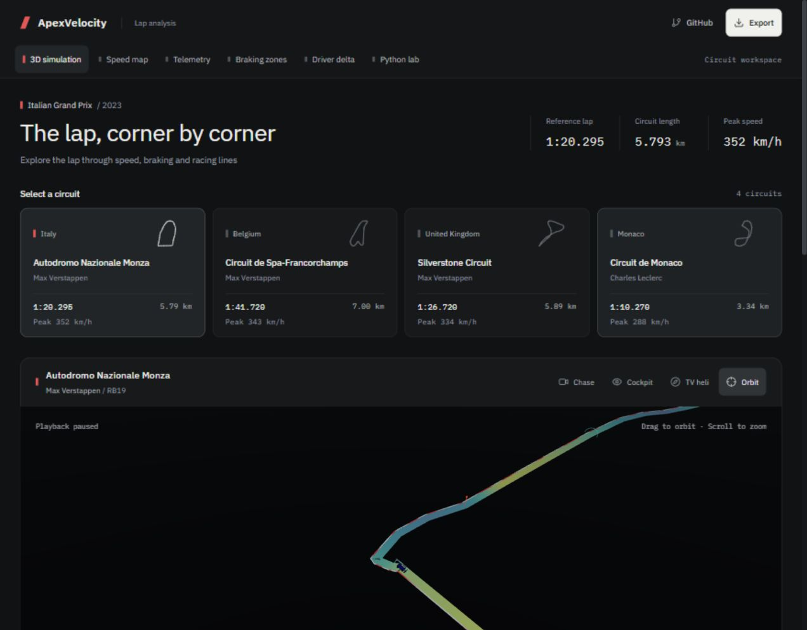

# ApexVelocity

An interactive Formula 1 lap analysis workspace built with React, TypeScript, and Three.js. Explore circuit speed maps, replay a simulated lap in 3D, inspect braking zones, and compare driver traces in a responsive pit-wall interface.



## Features

- Four circuits: Monza, Spa-Francorchamps, Silverstone, and Monaco.
- 3D lap playback with Chase, Cockpit, TV heli, and Orbit cameras.
- Speed-colored circuit maps with Viridis, Turbo, Plasma, and SpeedHeat palettes.
- Synchronized speed, throttle, brake, gear, DRS, and G-force instruments.
- Braking-zone inspection and driver speed comparisons.
- CSV and JSON export, plus downloadable FastF1/Matplotlib Python scripts.
- Responsive navigation and layouts for desktop, tablet, and mobile.

## Run locally

Use Node.js 22.12 or newer and npm. Node.js 24 was used for local verification.

```sh
git clone https://github.com/Kunwar-26/apexvelocity-f1-analyser.git
cd apexvelocity-f1-analyser
npm ci
npm run dev
```

Open <http://localhost:3000>. No API key or environment configuration is required for the current browser app. `.env.example` documents the optional development setting.

## Commands

| Command | Purpose |
| --- | --- |
| `npm run dev` | Start the Vite development server on port 3000 |
| `npm run lint` | Run TypeScript checks |
| `npm run build` | Build production files into `dist/` |
| `npm run preview` | Serve the production build locally |
| `npm run clean` | Remove generated `dist/` files |

Deploy the generated `dist/` directory to a static web host. The 3D view requires a browser with WebGL support.

## Data and scope

The browser uses bundled, waypoint-based demonstration telemetry. Circuit shapes, lap traces, car motion, and driver comparisons are illustrative, not a live timing feed or verified race measurements. CSV/JSON exports contain this demonstration data.

The Python lab generates a separate script that retrieves session data through FastF1. It does not run Python inside the browser. To use it, install Python and `fastf1`, `matplotlib`, and `numpy`, create a `fastf1_cache` directory, then run the downloaded script. An internet connection and session-data availability are required.

## Project structure

```text
src/
  components/       Analysis views, controls, and dialogs
    three/          Three.js scene, track, and procedural car
  data/circuits/    Bundled circuit waypoints and demo telemetry
  types/           Shared telemetry types
  utils/           Colormaps and Python script generation
  App.tsx          Workspace state and view composition
  index.css        Design tokens and responsive styles
public/             Static assets
docs/               Preview image
```

The application uses React 19, Vite, Tailwind CSS, Three.js, and Lucide icons. GitHub Actions checks TypeScript and the production build on pushes and pull requests.

This is an independent educational project and is not affiliated with Formula 1 or its teams. No open-source license has been selected for this repository.
